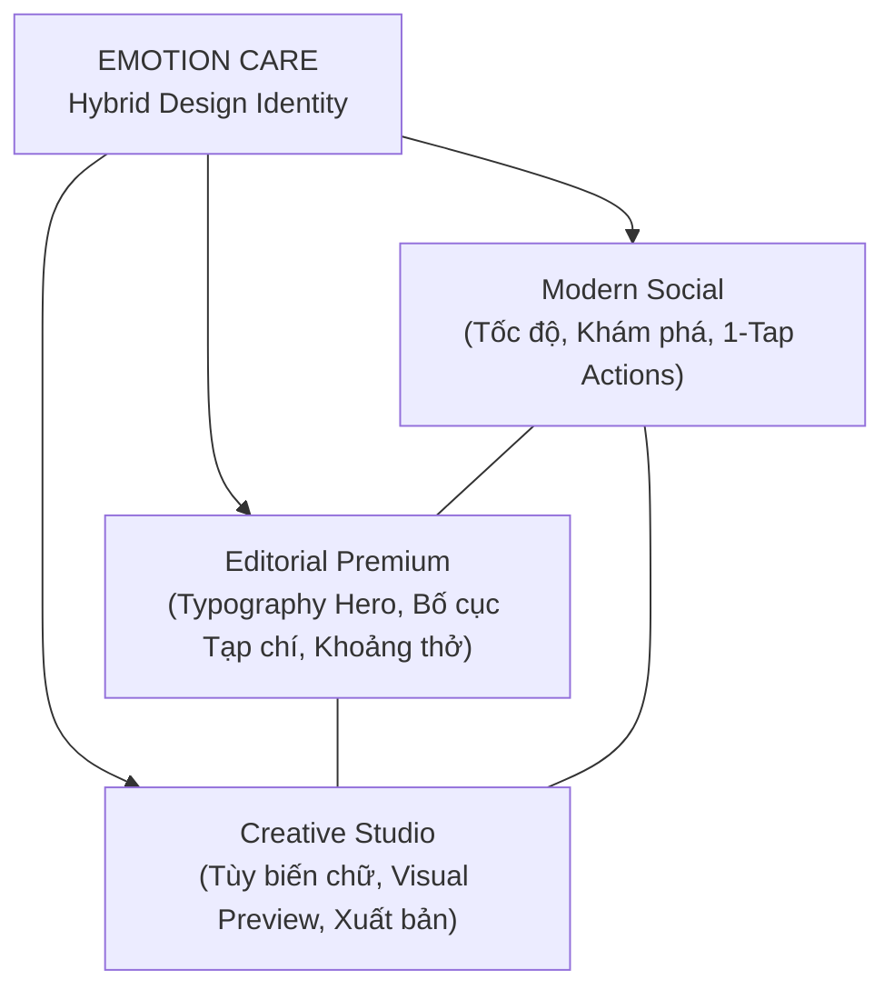
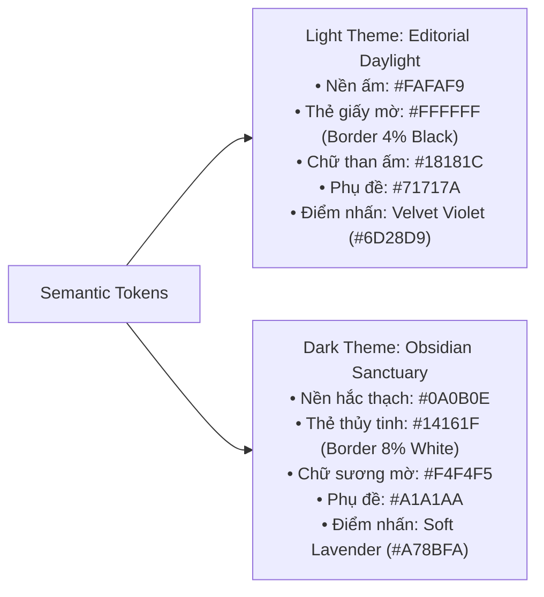
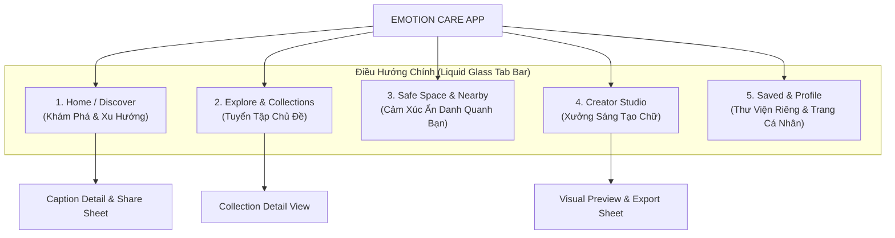
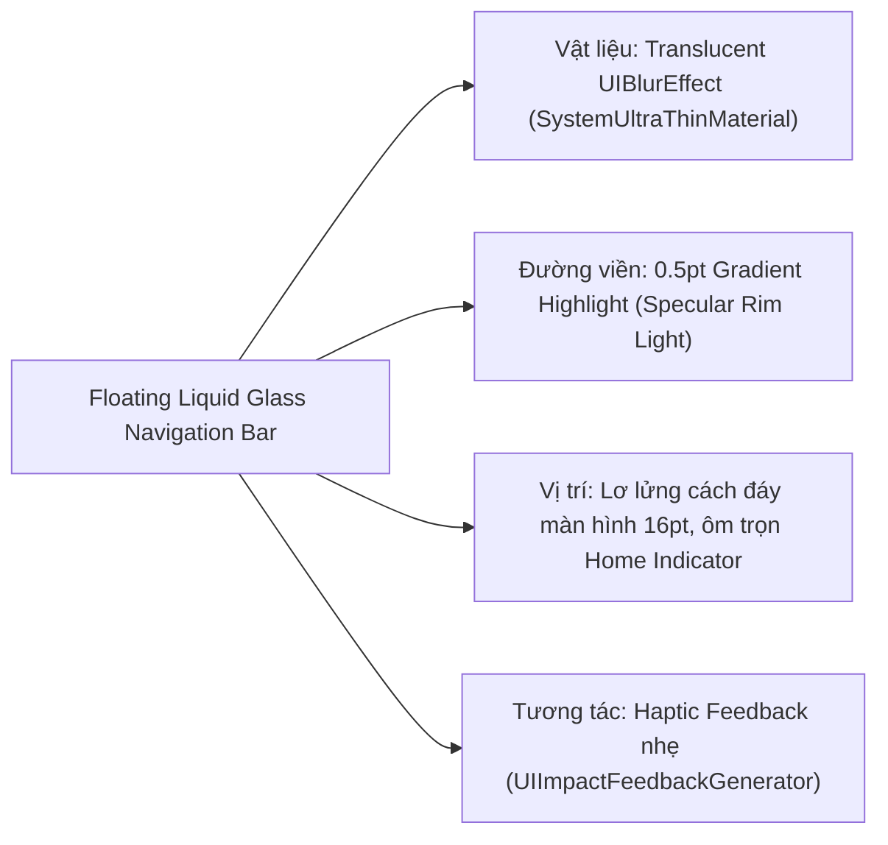

# EMOTION CARE — MASTER PRODUCT DESIGN & UI/UX SPECIFICATION
## Hybrid Creative Social · Adaptive Theme · Creator First · Native iOS 18+

> **Chức danh:** Principal Product Designer & Digital Art Director  
> **Phiên bản:** 1.0.0 (Production Design System)  
> **Mục tiêu:** Định hình ngôn ngữ thị giác, trải nghiệm tương tác (UX), hệ thống thành phần (Design System) và kiến trúc 11 màn hình cao cấp cho nền tảng sáng tạo câu từ **Emotion Care**.

---

# 1. TỔNG QUAN ĐỊNH VỊ SẢN PHẨM & NGHỆ THUẬT THỊ GIÁC

### 1.1. Định Vị Sản Phẩm (Product Positioning)
**Emotion Care không phải là một ứng dụng trị liệu tâm lý truyền thống, cũng không phải một clone mạng xã hội đại trà (Twitter/Threads) hay công cụ đồ họa rườm rà (Canva clone).**

Sản phẩm được định vị là:
> **"Nền tảng sáng tạo và khám phá nội dung chữ hiện đại — nơi người trẻ tìm thấy, thể hiện và lan tỏa những câu từ chạm đến cảm xúc."**

### 1.2. Tam Giác Nghệ Thuật (Hybrid Creative Editorial)
Sự kết hợp đồng nhất của 3 trường phái thiết kế thị giác:
1. **Modern Social:** Tốc độ lướt mượt mà, khám phá nội dung tự nhiên, phân phối thông minh, thao tác 1 chạm (1-Tap Copy & Share), chuẩn công thái học di động (Thumb Zone).
2. **Editorial Premium:** Phong cách tạp chí nghệ thuật cao cấp (Kinfolk, Cereal, Monocle), phân cấp typographic mạnh mẽ, khoảng thở (whitespace) có chủ đích, bố cục bất đối xứng tinh tế, coi câu chữ là tác phẩm nghệ thuật chính (Visual Hero).
3. **Creative Studio:** Không gian sáng tạo đắm chìm (Immersive Workspace), công cụ tùy biến font/màu/bố cục trực quan theo ngữ cảnh, bản xem trước tức thì (Live Preview), xuất bản đa nền tảng (Threads, Instagram Stories, TikTok text).

---

# 2. GIAI ĐOẠN 1 & 2: KHÁM PHÁ Ý TƯỞNG & LỰA CHỌN THIẾT KẾ (STAGES 1 & 2)

Để tìm ra ngôn ngữ hình ảnh tối ưu, chúng tôi đã phát triển và đối chiếu 3 khái niệm thiết kế độc lập (Concepts):

### 2.1. So Sánh 3 Khái Niệm Thiết Kế

| Tiêu chí | Concept A: Modern Social Discovery | Concept B: Editorial Premium | Concept C: Creative Hybrid (Được chọn) |
| :--- | :--- | :--- | :--- |
| **Cảm xúc chủ đạo** | Nhanh, năng động, đậm chất mạng xã hội | Trầm lắng, tĩnh tại, đậm tính văn học nghệ thuật | **Cân bằng hoàn hảo: Trẻ trung, sâu sắc và đầy cảm hứng sáng tạo** |
| **Mật độ thông tin** | Cao (dạng feed thẻ dồn dập như Threads) | Thấp - Trung bình (nhiều khoảng trắng, font lớn) | **Nhịp điệu biến thiên (Rhythmic Density): Xen kẽ Hero Quote & Snackable Cards** |
| **Vai trò của Chữ** | Nội dung bài đăng thông thường | Tác phẩm nghệ thuật đóng khung | **Visual Hero tương tác được: Vừa để đọc, vừa để Copy 1-chạm, vừa mở Studio edit** |
| **Thao tác tạo bài** | Nút FAB tròn nổi bật góc dưới | Thanh công cụ viết nhỏ ở header | **Floating Action Pill đắm chìm + Modal Studio trải nghiệm toàn màn hình** |
| **Điều hướng** | Tab bar chuẩn 5 icon phẳng | Menu tối giản dạng chữ | **Floating Liquid Glass Navigation Bar với blur vật liệu iOS 18 chân thực** |

### 2.2. Quyết Định Lựa Chọn: Concept C (Creative Hybrid)
**Lý do lựa chọn:**
* Concept A quá thương mại và biến app thành một mạng xã hội xô bồ, đánh mất giá trị thấu cảm.
* Concept B quá xa cách, tốc độ tiêu thụ nội dung chậm, gây cản trở cho người dùng phổ thông.
* **Concept C là giải pháp duy nhất giải quyết trọn vẹn cả 3 nhu cầu:** Lướt đọc tìm caption nhanh (Social), thưởng thức câu từ đẹp mắt (Editorial), và tự tay biến tấu chia sẻ ra ngoài (Creator).

---

# 3. HỆ THỐNG THIẾT KẾ THÍCH ỨNG (ADAPTIVE DESIGN SYSTEM)

Hệ thống màu sắc được thiết kế với hai bản sắc riêng biệt cho Sáng (Light) và Tối (Dark), không đơn thuần là đảo màu (Inversion):

### 3.1. Bảng Màu Adaptive Theme Tokens

| Token Semantic | Light Mode (Ban ngày rực rỡ) | Dark Mode (Đêm tĩnh lặng) | Mục đích sử dụng |
| :--- | :---: | :---: | :--- |
| `--surface-bg` | `#FAFAF9` *(Warm Alabaster)* | `#0A0B0E` *(Deep Obsidian)* | Nền chính của toàn ứng dụng |
| `--surface-card` | `#FFFFFF` | `#14161F` *(Frosted Slate)* | Bề mặt thẻ nội dung, danh mục |
| `--surface-elevated`| `#F4F4F6` | `#1C1F2E` | Bề mặt nổi (Sheets, Dialogs, Dropdowns) |
| `--surface-glass` | `rgba(255, 255, 255, 0.75)` | `rgba(20, 22, 31, 0.75)` | Thanh điều hướng Liquid Glass, Floating Header |
| `--border-subtle` | `rgba(0, 0, 0, 0.06)` | `rgba(255, 255, 255, 0.08)` | Đường viền mảnh 0.5pt phân cách thẻ |
| `--text-primary` | `#18181C` *(Deep Charcoal)* | `#F4F4F5` *(Warm White)* | Tiêu đề, câu trích dẫn chính |
| `--text-secondary` | `#71717A` *(Zinc 500)* | `#A1A1AA` *(Zinc 400)* | Tác giả, thông số thời gian, số lượt copy |
| `--text-tertiary` | `#A1A1AA` | `#52525B` | Placeholder, metadata phụ |
| `--accent-primary` | `#6D28D9` *(Royal Violet)* | `#A78BFA` *(Luminescent Lavender)*| Nút chính, badge Trending, active states |
| `--accent-secondary`| `#F59E0B` *(Warm Amber)* | `#FBBF24` *(Amber Glow)* | Điểm Viral Score, huy hiệu Top 1 |
| `--accent-healing` | `#059669` *(Emerald)* | `#34D399` *(Soft Mint)* | Trạng thái an toàn, an ủi, lắng nghe |

---

# 4. TYPOGRAPHY & NGHỆ THUẬT TRÌNH BÀY NỘI DUNG (HERO TYPOGRAPHY)

Typography là linh hồn của Emotion Care. Hệ thống sử dụng kết hợp giữa **Editorial Display** (cho câu trích dẫn đắt giá) và **Modern Grotesk** (cho giao diện điều khiển và phụ đề):

### 4.1. Thang Tỷ Lệ Font Chữ (Typography Scale)
* **Editorial Hero Display:** `Playfair Display` hoặc `New York` (iOS) — Dành riêng cho câu trích dẫn lớn:
  * Size: `22pt` – `28pt`, Line-height: `1.45`, Font-style: `Italic` nhẹ, Tracking: `-0.02em`.
* **Primary UI & Caption Sans:** `Plus Jakarta Sans` hoặc `SF Pro Display` (iOS):
  * Large Title: `24pt` (Bold, Tracking `-0.03em`)
  * Section Title: `18pt` (SemiBold, Tracking `-0.02em`)
  * Headline / Body Lead: `15pt` (Medium, Line-height `1.5`)
  * Body Text: `14pt` (Regular, Line-height `1.55`)
  * Callout & Badges: `12pt` (SemiBold, Uppercase Tracking `+0.04em`)
  * Caption & Metadata: `11pt` (Medium, Zinc Muted)

### 4.2. 6 Phong Cách Trình Bày Caption (Caption Presentation Archetypes)
Không ép mọi caption vào một mẫu thẻ đơn điệu:
1. **The Minimalist (Thuần chữ tối giản):** Chữ lớn trên nền đơn sắc có texture sần nhẹ, căn lề trái tự nhiên, tạo cảm giác tĩnh tại như đọc một trang nhật ký.
2. **The Editorial Quote (Trích dẫn tạp chí):** Có đường viền đứng nghệ thuật (Accent bar), font serif nghiêng, kèm dấu ngoặc kép cách điệu.
3. **The Ambient Atmosphere (Bầu không khí cảm xúc):** Nền gradient mờ ảo (Aurora Blur) đổi màu theo sắc thái cảm xúc (Cam hổ phách ấm cho vui vẻ, Xanh lam chàm cho trầm tư, Tím khói cho tĩnh lặng).
4. **The Split Asymmetric (Bố cục lệch hiện đại):** 1/3 ảnh chụp phim cinematic chân thật kết hợp 2/3 không gian typography thoáng đãng.
5. **The Micro-Poetry (Thơ ngắn & Đối câu):** Căn giữa thanh lịch, ngắt nhịp thơ có khoảng cách dòng rộng rãi.
6. **The Viral Punchline (Câu nói viral đanh thép):** Chữ đậm (ExtraBold Sans), kích thước lớn, tương phản cực cao, thiết kế tối ưu để chụp màn hình đăng story Instagram/Threads.

---

# 5. ĐẶC TẢ CHI TIẾT 11 MÀN HÌNH NATIVE iOS

---

### MÀN HÌNH 01: HOME / DISCOVER (Trang Chủ Khám Phá)
* **Header:** Thanh tiêu đề thương hiệu siêu thanh mảnh với logo monogram `EC`, định vị vị trí hiện tại mờ nhẹ (`• Quận 1, TP.HCM`), nút tìm kiếm nhanh và thông báo.
* **Hero Section (Bản Tin Nổi Bật):** "Câu Chữ Của Ngày" (Quote of the Day) trình bày theo phong cách bìa tạp chí, kèm nút **1-Tap Copy** lập tức có phản hồi haptic.
* **Curated Carousel (Băng chuyền Tuyển tập):** Trượt ngang các bộ sưu tập đặc sắc dạng bìa sách nghệ thuật (ví dụ: *"Những câu chữ dành cho ngày mưa"*, *"Tuổi trẻ và những ngã rẽ"*).
* **Trending Feed Stream:** Dòng chảy các caption viral được chấm điểm cao nhất trong 24 giờ.

---

### MÀN HÌNH 02: EXPLORE & TOPICS (Khám Phá Chuyên Đề)
* **Search Bar:** Ô tìm kiếm bo tròn ôm sát, icon kính lúp mềm, gợi ý từ khóa nóng (`#ChữaLành`, `#ThảThính`, `#TrưởngThành`, `#BìnhYên`).
* **Mood Taxonomy Grid:** Bố cục modular gồm 6 khối cảm xúc chính. Mỗi khối có màu nền pastel thanh lịch, icon nét mảnh độc quyền (không dùng emoji vàng tròn đại trà).
* **Curated Authors (Bút danh nổi bật):** Danh sách các tác giả cộng đồng có nhiều caption được copy nhất tuần.

---

### MÀN HÌNH 03: CAPTION FEED (Dòng Chảy Nội Dung Sáng Tạo)
* **Cấu trúc thẻ Post Card đa dạng:** Thay đổi xen kẽ giữa thẻ chữ tối giản và thẻ có hình nền ảnh phim mờ.
* **Hàng tương tác công thái học (Bottom Action Bar):**
  * Nút **1-Tap Copy** màu Amber/Violet nổi bật: Nhấn vào lập tức copy nội dung kèm hashtag thương hiệu, hiển thị Toast mượt mà và tăng số đếm copy.
  * Bộ 3 cảm xúc thấu cảm: 🫂 *Ôm một cái*, 👂 *Lắng nghe*, 💫 *Ở đây với bạn*.
  * Nút Bookmark lưu vào Bộ sưu tập cá nhân.

---

### MÀN HÌNH 04: CAPTION DETAIL (Đọc Đắm Chìm)
* Toàn màn hình tập trung 100% vào câu chữ. Nền tối giản tối đa, khoảng cách lề lớn (padding 28pt) giúp mắt thư giãn.
* Phía dưới hiển thị thông tin Bút danh tác giả, ngày sáng tác, chuyên mục cảm xúc và các bài viết liên quan có cùng tâm trạng.

---

### MÀN HÌNH 05: SEARCH & FILTER (Tìm Kiếm Thông Minh)
* Tìm kiếm ngữ nghĩa kết hợp Elasticsearch: Cho phép gõ tâm trạng tự nhiên (ví dụ: *"đang thấy cô đơn giữa đám đông"*), hệ thống tự động tìm vector tương đồng trả về các câu trích dẫn phù hợp nhất.
* Bộ lọc chuyên sâu: Theo cảm xúc, theo độ dài (Ngắn, Vừa, Thơ), theo độ thịnh hành.

---

### MÀN HÌNH 06: COLLECTION DETAIL (Chi Tiết Bộ Sưu Tập Tuyển Chọn)
* Bìa ảnh khổ lớn phía trên với hiệu ứng Parallax mượt mà khi cuộn.
* Tiêu đề bộ sưu tập viết bằng font Editorial Display trang trọng, kèm lời tựa của người tuyển chọn.
* Nút *"Lưu toàn bộ tuyển tập"* và danh sách các caption liên quan bên dưới.

---

### MÀN HÌNH 07: CREATOR STUDIO (Xưởng Sáng Tạo Chữ)
* **Vùng soạn thảo (Distraction-Free Writing Canvas):** Bề mặt viết chữ thoáng đãng, tự động giãn nở theo nội dung, không có bất kỳ nút bấm rườm rà nào che mắt.
* **Contextual Creative Dock (Thanh công cụ ngữ cảnh nổi):**
  * Nút chọn Mood & Tags.
  * Nút đổi Typography (Serif, Sans, Mono, Cursive).
  * Nút đổi phong cách nền (Monochrome, Soft Grain, Amber Aura, Cinematic Photo).
  * **"✨ Để AI Gieo Vần":** Kích hoạt Gemini RAG để gợi ý 3 cách diễn đạt cảm xúc ([Nhẹ nhàng], [Bộc trực], [Nghệ thuật]).
* **Nút bấm Preview & Xuất Bản** ở góc phải thanh trên cùng.

---

### MÀN HÌNH 08: VISUAL PREVIEW & EXPORT (Xem Trước & Chia Sẻ)
* Trình diễn chính xác cách caption sẽ hiển thị khi chia sẻ:
  * Khổ dọc 9:16 (Dành cho Instagram Stories / TikTok / Facebook Reels).
  * Khổ vuông 1:1 (Dành cho bài đăng Feed mạng xã hội).
  * Khổ chữ tối giản (Copy văn bản sạch vào clipboard).
* Nút xuất ảnh độ phân giải cao (Retina 3x) và nút chia sẻ trực tiếp sang Instagram Stories qua Native iOS Share Sheet.

---

### MÀN HÌNH 09: SAVED LIBRARY (Thư Viện Lưu Trữ Cá Nhân)
* Tổ chức dưới dạng các "Cuốn sổ tay" cá nhân (ví dụ: *Những câu làm mình mỉm cười*, *Trích dẫn sách hay*, *Bản nháp dang dở*).
* Trải nghiệm lưu trữ văn minh, tôn vinh thói quen sưu tầm câu chữ đẹp.

---

### MÀN HÌNH 10: CREATOR PROFILE (Hồ Sơ Tác Giả & Cá Nhân)
* Bút danh sáng tạo (`@author_alias`), châm ngôn cá nhân, tổng số lượt caption đã được cộng đồng sao chép (`12.4k lượt copy`).
* Danh sách các tác phẩm đã đăng, phân chia theo thẻ: *Đã đăng*, *Bộ sưu tập*, *Bản nháp riêng tư*.
* Không đặt nặng số người theo dõi (Follower counts) để tránh áp lực đồng trang lứa.

---

### MÀN HÌNH 11: SAFE SPACE & NEARBY (Không Gian An Toàn Lân Cận)
* Điểm giao tiếp tế nhị của Mode 1: Giao diện chuyển sang gam màu đêm huyền ảo (Midnight Ambient Glow).
* Hiển thị các bài viết cảm xúc ẩn danh xung quanh bán kính 1km - 5km.
* Mỗi bài viết có nhãn đếm ngược thời gian tự hủy (`⏳ Tự biến mất sau 7 ngày`).
* Hoàn toàn không có số đếm tương tác hay bảng xếp hạng — chỉ có những nút gửi cái ôm và sự lắng nghe vô điều kiện.

---

# 6. ĐẶC TẢ THANH ĐIỀU HƯỚNG NATIVE iOS LIQUID GLASS

* **Cấu trúc:** Thanh điều hướng nổi lơ lửng (Floating Capsule), tách biệt khỏi cạnh dưới màn hình 16pt.
* **Hiệu ứng khúc xạ:** Sử dụng vật liệu làm mờ thấu kính (Frosted Glassmorphism) kết hợp đường viền highlight phản xạ ánh sáng siêu mảnh ở cạnh trên (0.5pt white border với opacity 20%).
* **5 Điểm chạm trực quan:**
  1. `Khám Phá` (La bàn cách điệu)
  2. `Chủ Đề` (Sách/Tuyển tập)
  3. **`Sáng Tạo (+)` (Nút trung tâm Capsule phát sáng gradient)**
  4. `Lân Cận` (Sóng radar cảm xúc an toàn)
  5. `Thư Viện` (Dấu trang cá nhân)

---

# 7. QUY CHUẨN MOTION DESIGN & MICRO-INTERACTIONS

1. **Hiệu ứng 1-Tap Copy:**
   - Khi bấm "Sao chép": Nút bấm co nhẹ (`scale: 0.95`), nhịp rung haptic `medium`, icon chuyển thành dấu tích xanh `✓ Đã sao chép`, số lượt copy nhảy số dạng bánh xe (slot counter animation).
   - Một thông báo Toast dạng viên thuốc mờ (Pill Toast) rơi nhẹ từ Dynamic Island xuống trong 0.3s với thông điệp: *"Đã lưu caption vào bộ nhớ tạm kèm #EmotionCare ✨"*.
2. **Hiệu ứng Thả Cảm Xúc (Empathy Reaction):**
   - Bấm vào icon Ôm (`🫂`): Icon nở lớn nhẹ kèm hiệu ứng hạt ánh sáng (sparkles) lan tỏa và số lượng tăng lên êm ái.
3. **Chuyển Đổi Tab & Mở Modal:**
   - Dùng lò xo vật lý tự nhiên (Spring Physics: `damping: 0.82`, `stiffness: 280`), loại bỏ cảm giác giật cục của web app thông thường.

---

# 8. KẾT LUẬN & BẢN XEM TRƯỚC TƯƠNG TÁC (INTERACTIVE PROTOTYPE)

Hệ thống thiết kế này đã được hiện thực hóa thành **Bản Mẫu Tương Tác Trực Tiếp (Interactive Prototype)** chuẩn iPhone 16 Pro tại:

👉 **[modern-ui-redesign.html](file:///C:/Users/dqtoa/.gemini/antigravity/brain/b4b93bcf-8787-487b-9c95-3d0f36b939b9/modern-ui-redesign.html)**

*(Bản mẫu cho phép bấm chuyển đổi mượt mà giữa Chế độ Chữa Lành và Chế độ Caption Viral, bấm thử nút 1-Tap Copy, kiểm tra phản hồi haptic toast, và chiêm ngưỡng thanh điều hướng Liquid Glass chân thực).*
