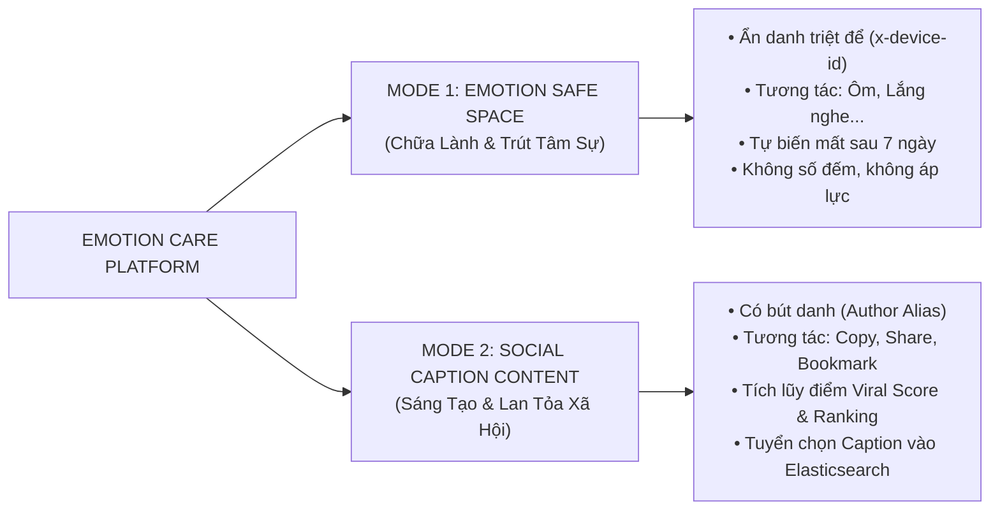
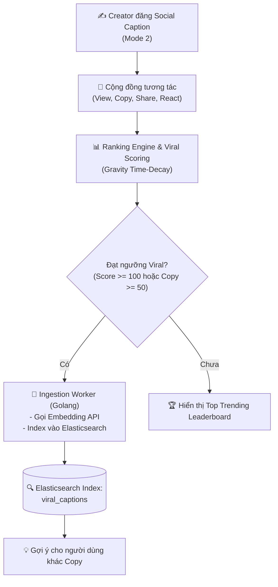
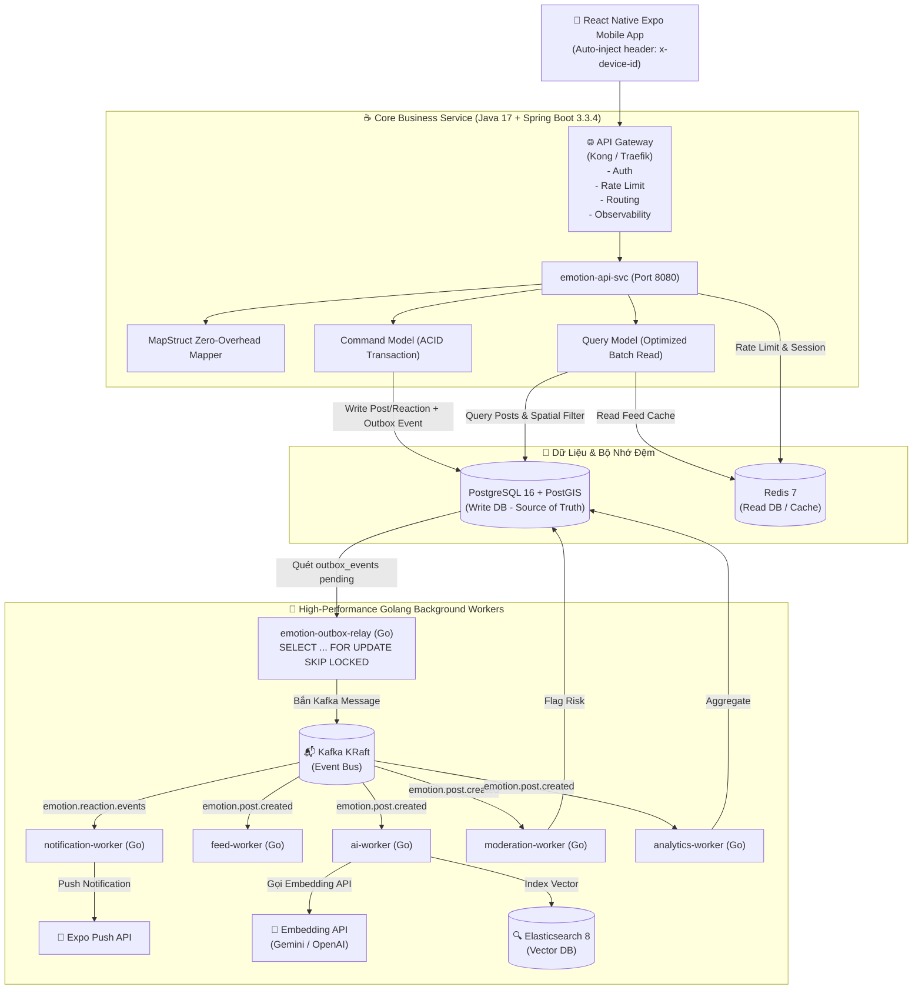
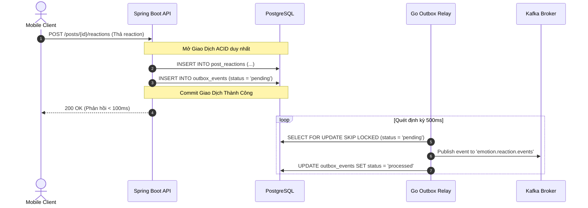
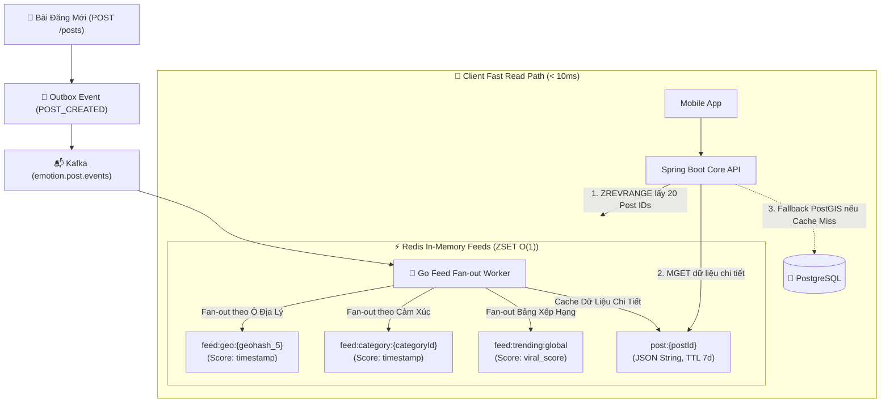
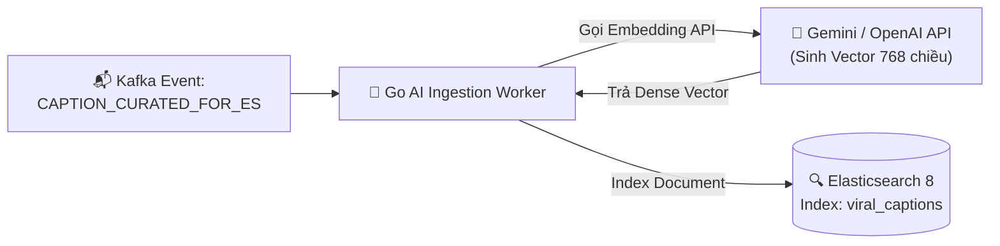
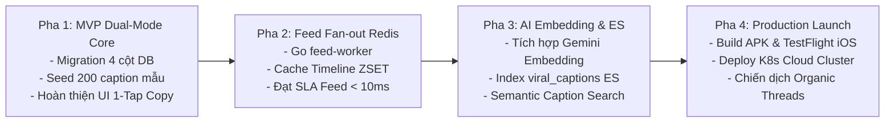

# EMOTION CARE PLATFORM
## FINAL ARCHITECTURE SPECIFICATION (Bản Hợp Nhất Cuối Cùng)

> **Phiên bản:** 4.0.0 (Final Unified Architecture)  
> **Trạng thái:** ✅ Single Source of Truth — Thay thế toàn bộ các tài liệu tiền nhiệm  
> **Ngày ban hành:** 2026-11-22  
> **Phạm vi:** Tầm nhìn sản phẩm, Kiến trúc phân tán, Database Schema, Thuật toán, AI/RAG (API-based), DevOps

### Lịch Sử Phiên Bản (Changelog & Version History)

> **Chính sách quản lý phiên bản:** Mọi thay đổi đối với tài liệu kiến trúc này đều phải tạo bản snapshot lưu trữ tương ứng trong thư mục [`docs/versions/`](file:///c:/source/emotion-care/docs/versions/) với tên file định dạng `MASTER-SPECIFICATION-vX.Y.Z.md` và ghi nhận nhật ký vào bảng dưới đây.

| Phiên bản | Ngày cập nhật | Tác giả / Người duyệt | Tóm tắt các thay đổi chính | Bản lưu trữ |
| :---: | :---: | :---: | :--- | :---: |
| **`v4.0.0`** | 2026-11-22 | Solution Architect | • Bổ sung NFRs, SLA & Data Retention Policy.<br>• Chuyển đổi AI sang mô hình API-Based (bỏ Local Ollama).<br>• Mở rộng 6 Go Workers (có feed-worker).<br>• **Đặc tả toàn diện Feed Fan-out on Write & Redis ZSET**.<br>• Chuẩn hóa API RESTful và cấu trúc 15 chương. | [v4.0.0](file:///c:/source/emotion-care/docs/versions/MASTER-SPECIFICATION-v4.0.0.md) |
| **`v3.0.0`** | 2026-11-22 | Core Team | • Hợp nhất toàn bộ tài liệu cũ từ NestJS và các file rời rạc.<br>• Khởi tạo tài liệu Master Specification 9 chương đầu tiên. | [v3.0.0](file:///c:/source/emotion-care/docs/versions/MASTER-SPECIFICATION-v3.0.0.md) |

---

# MỤC LỤC

1. [Tổng Quan Sản Phẩm & Chiến Lược Dual-Mode](#1-tổng-quan-sản-phẩm--chiến-lược-dual-mode)
2. [Mục Tiêu Phi Chức Năng & SLA](#2-mục-tiêu-phi-chức-năng--sla)
3. [Kiến Trúc Hệ Thống Phân Tán](#3-kiến-trúc-hệ-thống-phân-tán)
4. [Các Miền Nghiệp Vụ Cốt Lõi](#4-các-miền-nghiệp-vụ-cốt-lõi)
5. [Bảng Mã Màu & Icon Cảm Xúc](#5-bảng-mã-màu--icon-cảm-xúc)
6. [Transactional Outbox & Event Streaming](#6-transactional-outbox--event-streaming)
7. [Thuật Toán Feed & Xếp Hạng Viral](#7-thuật-toán-feed--xếp-hạng-viral)
8. [Kiến Trúc AI (API-Based) & Vector Search](#8-kiến-trúc-ai-api-based--vector-search)
9. [Từ Điển Cơ Sở Dữ Liệu Toàn Tập](#9-từ-điển-cơ-sở-dữ-liệu-toàn-tập)
10. [Thiết Kế Redis & Kafka](#10-thiết-kế-redis--kafka)
11. [API Design](#11-api-design)
12. [Bảo Mật & An Toàn](#12-bảo-mật--an-toàn)
13. [Observability & Vận Hành](#13-observability--vận-hành)
14. [Hướng Dẫn Triển Khai](#14-hướng-dẫn-triển-khai)
15. [Lộ Trình Phát Triển](#15-lộ-trình-phát-triển)

---

# 1. TỔNG QUAN SẢN PHẨM & CHIẾN LƯỢC DUAL-MODE

### 1.1. Tầm Nhìn Sản Phẩm

Trong bối cảnh các mạng xã hội truyền thống (Facebook, Instagram, Threads, TikTok) ngập tràn sự phô diễn thành tích và tạo ra áp lực đồng trang lứa (Peer Pressure), **Emotion Care Platform** ra đời như một không gian nhân văn:

* Nơi cảm xúc tiêu cực (buồn bã, cô đơn, áp lực, mệt mỏi) được chấp nhận và lắng nghe an toàn.
* Nơi người dùng tìm thấy sự thấu cảm từ những người có cùng tâm trạng quanh khu vực địa lý.
* Nơi những câu từ, caption sáng tạo sâu sắc được tôn vinh và lan tỏa.

### 1.2. Chiến Lược Dual-Mode Architecture

Hệ thống tích hợp 2 chế độ trải nghiệm riêng biệt nhưng bổ trợ lẫn nhau, được cấu hình trong **Cài đặt thiết bị (`device_settings`)**:



| Tiêu chí | Mode 1: Emotion Safe Space | Mode 2: Social Caption Content |
| :--- | :--- | :--- |
| **Mục đích** | Giải tỏa áp lực tâm lý, trút bầu tâm sự. | Sáng tạo caption hay, lấy nội dung đăng mạng xã hội. |
| **Danh tính** | Ẩn danh 100% theo thiết bị. | Ẩn danh hoặc kèm Bút danh sáng tạo (`author_alias`). |
| **Tương tác cốt lõi**| Empathy Reactions (Ôm, Lắng nghe, Ở đây với bạn). | **Nút sao chép 1 chạm (`Copy to Clipboard`)**, Share, Bookmark. |
| **Vòng đời bài** | **Tự hết hạn sau 7 ngày** (`expired_at`). | **Vĩnh viễn**, tích lũy điểm thưởng và bảng xếp hạng. |
| **Xếp hạng** | Phân phối theo thời gian và bán kính địa lý. | **Leaderboard Ranking** (Top Ngày, Top Tuần, Trending). |
| **Tích hợp AI** | Nhận gợi ý an ủi nhẹ nhàng. | Caption Viral được nạp vào Elasticsearch để AI học sinh câu mới. |
| **UI/UX** | Nền tối nhẹ, tập trung vào cảm xúc, hiển thị khoảng cách km. | Giao diện sáng, typography nổi bật, huy hiệu **Top Trending**. |

### 1.3. Vòng Lặp Lan Tỏa (Viral Growth Loop & Data Flywheel)



---

# 2. MỤC TIÊU PHI CHỨC NĂNG & SLA

### 2.1. Mục Tiêu Mở Rộng (Scale Targets)

| Metric | Target |
| :--- | :--- |
| **Total Users** | 10M+ |
| **DAU (Daily Active Users)** | 1M+ |
| **Posts/Day** | 5M+ |
| **Reactions/Day** | 50M+ |
| **Notifications/Day** | 20M+ |
| **Kafka Events/Day** | 100M+ |
| **Vector Documents (Elasticsearch)** | 1B+ |
| **Phạm vi địa lý** | Toàn cầu (Global) |

### 2.2. Cam Kết Chất Lượng Dịch Vụ (SLA)

| Component | SLA Target |
| :--- | :--- |
| **Feed Query (In-Memory Redis Fan-out)** | < 10 ms |
| **Feed Query (PostgreSQL PostGIS Fallback)** | < 200 ms |
| **Create Post** | < 500 ms |
| **React Post** | < 100 ms |
| **Push Notification Delivery** | < 10 giây |
| **Vector Search (Elasticsearch)** | < 300 ms |
| **Uptime (Core API)** | 99.95% |

### 2.3. Chính Sách Lưu Trữ Dữ Liệu (Data Retention Policy)

| Data | Retention | Ghi chú |
| :--- | :--- | :--- |
| **Emotion Post (Mode 1)** | 7 ngày | Tự động xóa qua cron job hoặc TTL |
| **Emotion Post (Mode 2)** | Vĩnh viễn | Tích lũy điểm Viral |
| **Feed Cache (Redis)** | 24 giờ | TTL tự động |
| **Notification Counter (Redis)** | 30 ngày | TTL tự động |
| **AI Suggestions** | 90 ngày | Dọn dẹp định kỳ |
| **Moderation Cases** | 180 ngày | Tuân thủ quy định |
| **Safety Incidents** | 3 năm | Lưu trữ pháp lý |
| **Outbox Events** | 30 ngày | Sau khi processed |
| **Analytics Aggregation** | Vĩnh viễn | Dữ liệu tổng hợp |

---

# 3. KIẾN TRÚC HỆ THỐNG PHÂN TÁN

### 3.1. Sơ Đồ Kiến Trúc Tổng Thể (Polyglot Event-Driven Microservices + CQRS Lite)



### 3.2. Điểm Mạnh Công Nghệ (Technology Strengths)

1. **Spring Boot 3 (Core Service):** Quản lý toàn vẹn giao dịch DB phức tạp (ACID), Liquibase schema migration, MapStruct tối ưu bộ nhớ thay thế Reflection, Spring Security.
2. **Golang (Workers):** Tiêu thụ siêu ít RAM (~15MB/worker), Goroutines non-blocking xử lý hàng chục ngàn sự kiện Kafka mỗi giây, hiệu năng cao cho I/O-bound operations.
3. **PostGIS (Spatial Engine):** Tính toán khoảng cách địa lý theo tọa độ thực (`ST_DWithin`), Index GIST cho truy vấn không gian nhanh.
4. **Kafka KRaft:** Loại bỏ Zookeeper dependency, Partitioning theo `geohash` cho post events, Replication Factor = 3 cho High Availability.
5. **Elasticsearch 8:** Vector Database cho semantic search, Dense Vector 768 chiều, k-NN Search + metadata filter kết hợp.

### 3.3. Trách Nhiệm Từng Thành Phần (Component Responsibilities)

* **API Gateway (Kong / Traefik):** Authentication (`x-device-id`), Rate Limiting (Redis-backed), Request Validation, Routing, Distributed Tracing.
* **Core API Service (Spring Boot):** CRUD Emotion Posts & Captions, Reactions, Device Settings, Transactional Outbox.
* **Go Outbox Relay:** Quét `outbox_events` định kỳ với `FOR UPDATE SKIP LOCKED` và đẩy Kafka.
* **Go Feed Fan-out Worker:** Phân phối bài viết vào các ZSET Redis (`feed:geo`, `feed:category`, `feed:trending`).
* **Go AI Worker:** Gọi Embedding API và đồng bộ các caption viral vào Elasticsearch.
* **Go Notification Worker:** Gửi Push Notification qua Expo API.
* **Go Moderation Worker:** Quét từ khóa tự hại/khủng hoảng và gắn cờ cảnh báo an toàn.

---

# 4. CÁC MIỀN NGHIỆP VỤ CỐT LÕI

### 4.1. Miền Thiết Bị & Quyền Riêng Tư (Device & Privacy Domain)

* **Zero Registration:** Không tài khoản, không mật khẩu. Nhận diện thiết bị qua HTTP Header `x-device-id` (UUIDv4).
* **Cài đặt cá nhân hóa (`device_settings`):**
  * `app_mode`: `EMOTION_ONLY`, `SOCIAL_CAPTION`, hoặc `DUAL_MODE`.
  * `author_alias`: Bút danh hiển thị khi sáng tạo caption.
  * `approximate_location`: Làm mờ tọa độ thật khi quét bài xung quanh.
  * `low_pressure_mode`: Ẩn hoàn toàn số lượng tương tác, tắt thông báo gây xao nhãng.
  * `share_nearby` / `receive_nearby`: Quyền phát và nhận bài theo bán kính địa lý.

### 4.2. Miền Phân Loại Cảm Xúc (Emotion Taxonomy 2 Tầng)

* **Tầng 1 (Category - 6 nhóm chính):**

| Code | Tên | Icon đại diện |
| :--- | :--- | :--- |
| `happy` | Vui vẻ | sun |
| `sad` | Buồn | cloud-rain |
| `tired` | Mệt mỏi | bed |
| `stressed` | Căng thẳng | zap |
| `lonely` | Cô đơn | moon |
| `excited` | Phấn khích | rocket |

* **Tầng 2 (Tags - Sắc thái cụ thể):**
  * *Vui vẻ*: Hy vọng, Biết ơn, Bình yên.
  * *Buồn*: Chia tay, Tổn thương, Hụt hẫng.
  * *Mệt mỏi*: Mất ngủ, Cạn kiệt năng lượng.
  * *Căng thẳng*: Lo lắng, Áp lực công việc, Quá tải.
  * *Cô đơn*: Không ai hiểu mình, Cô đơn giữa đám đông.
  * *Phấn khích*: Hào hứng, Thành tựu mới.

### 4.3. Miền Tương Tác Thấu Cảm (Empathy Reaction Domain)

5 loại phản hồi mang tính chữa lành (thay thế "Like"):

| ID | Code | Tên | Ý nghĩa |
| :---: | :--- | :--- | :--- |
| 1 | `listen` | Lắng nghe | Tôi đang nghe bạn |
| 2 | `hug` | Ôm một cái | Gửi một cái ôm ấm áp |
| 3 | `support` | Ở đây với bạn | Bạn không cô đơn |
| 4 | `cheer` | Cố lên nhé | Động viên tinh thần |
| 5 | `empathy` | Tôi hiểu cảm giác này | Đồng cảm sâu sắc |

* **Quy tắc tương tác (Toggle & Replace):** Mỗi người dùng chỉ giữ tối đa 1 reaction trên mỗi bài viết (`UNIQUE(post_id, device_id)`). Bấm vào reaction đang chọn sẽ hủy (`REMOVED`), bấm vào reaction khác sẽ đổi loại (`UPDATED`).

### 4.4. Miền An Toàn & Hỗ Trợ Khủng Hoảng (Safety & Moderation Domain)

* **Posting Rate Limit:** Giới hạn tối đa số bài đăng mỗi ngày theo thiết bị (`posting_rate_limits`) để ngăn chặn spam bot.
* **Hàng đợi kiểm duyệt nguy cơ (`moderation_queue`):** Quét từ khóa tự hại (`SELF_HARM`), tự tử (`SUICIDE`), bạo lực (`VIOLENCE`). Bài viết có điểm nguy cơ cao tự động chuyển trạng thái `Flagged (status = 2)` và hiển thị popup đường dây nóng hỗ trợ tâm lý khẩn cấp (Crisis Helpline: Tổng đài Quốc gia 111, Viện Sức Khỏe Tâm Thần).

---

# 5. BẢNG MÃ MÀU & ICON CẢM XÚC

### 5.1. Bảng Tra Cứu Màu Sắc & Icon
| Cảm xúc | Icon Key | Mã Màu Chữ | Nền Thẻ | Ý nghĩa |
| :--- | :--- | :---: | :---: | :--- |
| **Vui vẻ (`happy`)** | `sun`, `sparkles`, `rainbow`, `party-popper` | `#F59E0B` | `#FEF3C7` | Ánh nắng rực rỡ, lạc quan, cầu vồng hy vọng |
| **Buồn (`sad`)** | `cloud-rain`, `droplets`, `moon`, `umbrella` | `#3B82F6` | `#DBEAFE` | Mây mưa ảm đạm, giọt lệ, sự che chở |
| **Mệt mỏi (`tired`)**| `bed`, `moon-star`, `battery-low`, `coffee` | `#8B5CF6` | `#EDE9FE` | Cần nghỉ ngơi, cạn năng lượng, đêm dài |
| **Căng thẳng (`stressed`)**| `zap`, `flame`, `alarm`, `cloud-lightning`| `#EF4444`| `#FEE2E2` | Áp lực dồn dập, bốc hỏa, báo động |
| **Cô đơn (`lonely`)**| `moon`, `heart-crack`, `cloud`, `person` | `#6366F1` | `#E0E7FF` | Một mình giữa đêm, tim vỡ, trống trải |
| **Phấn khích (`excited`)**| `rocket`, `trophy`, `sparkles`, `party-popper`| `#F97316`| `#FFEDD5` | Thăng hoa, thành tựu, bùng nổ năng lượng |

### 5.2. Mã Nguồn TypeScript Tham Khảo (Cho Mobile Client)

```typescript
export const ICON_MOODS = {
  happy: [
    { key: "sun", color: "#F59E0B", bgColor: "#FEF3C7" },
    { key: "sparkles", color: "#FBBF24", bgColor: "#FEF3C7" },
    { key: "rainbow", color: "#FB923C", bgColor: "#FED7AA" },
    { key: "party-popper", color: "#F97316", bgColor: "#FFEDD5" }
  ],
  sad: [
    { key: "cloud-rain", color: "#3B82F6", bgColor: "#DBEAFE" },
    { key: "droplets", color: "#06B6D4", bgColor: "#CFFAFE" },
    { key: "moon", color: "#6366F1", bgColor: "#E0E7FF" },
    { key: "umbrella", color: "#60A5FA", bgColor: "#DBEAFE" }
  ],
  tired: [
    { key: "bed", color: "#8B5CF6", bgColor: "#EDE9FE" },
    { key: "moon-star", color: "#7C3AED", bgColor: "#DDD6FE" },
    { key: "battery-low", color: "#A78BFA", bgColor: "#EDE9FE" },
    { key: "coffee", color: "#6D4C41", bgColor: "#EFEBE9" }
  ],
  stressed: [
    { key: "zap", color: "#EF4444", bgColor: "#FEE2E2" },
    { key: "flame", color: "#F97316", bgColor: "#FFEDD5" },
    { key: "alarm", color: "#DC2626", bgColor: "#FEE2E2" },
    { key: "cloud-lightning", color: "#E11D48", bgColor: "#FFE4E6" }
  ],
  lonely: [
    { key: "moon", color: "#6366F1", bgColor: "#E0E7FF" },
    { key: "heart-crack", color: "#EC4899", bgColor: "#FCE7F3" },
    { key: "cloud", color: "#94A3B8", bgColor: "#F1F5F9" },
    { key: "person", color: "#64748B", bgColor: "#E2E8F0" }
  ],
  excited: [
    { key: "rocket", color: "#F97316", bgColor: "#FFEDD5" },
    { key: "trophy", color: "#EAB308", bgColor: "#FEF9C3" },
    { key: "sparkles", color: "#F59E0B", bgColor: "#FEF3C7" },
    { key: "party-popper", color: "#EC4899", bgColor: "#FCE7F3" }
  ]
};
```

---

# 6. TRANSACTIONAL OUTBOX & EVENT STREAMING

### 6.1. Mẫu Thiết Kế Transactional Outbox



### 6.2. Cấu Trúc Outbox Event Envelope
```json
{
  "id": "c1f7a240-67c2-494b-9e4a-4e2b023e1f01",
  "aggregateType": "POST_REACTION",
  "aggregateId": "550e8400-e29b-41d4-a716-446655440000",
  "eventType": "REACTION_ADDED",
  "idempotencyKey": "REACTION:550e8400:device-01:ADDED:1732262400000",
  "status": "pending",
  "payload": {
    "postId": "550e8400-e29b-41d4-a716-446655440000",
    "postAuthorDeviceId": "8b846e4b-7221-4389-9a22-38e92ec4917a",
    "actorDeviceId": "9c123456-7890-4321-b123-abcdef123456",
    "reactionTypeId": 2,
    "reactionTypeName": "Ôm một cái",
    "action": "ADDED",
    "timestamp": "2026-11-22T15:45:00Z"
  }
}
```

---

# 7. THUẬT TOÁN FEED & XẾP HẠNG VIRAL

### 7.1. Thuật Toán Truy Vấn Feed Cảm Xúc Lân Cận (Mode 1 - Fallback)
```sql
SELECT p.*, 
       ST_Distance(p.location, ST_SetSRID(ST_MakePoint(:userLng, :userLat), 4326)::geography) AS distance_meters
FROM emotion_posts p
WHERE p.status = 1 
  AND p.post_mode = 'EMOTION'
  AND p.expired_at > CURRENT_TIMESTAMP
  AND ST_DWithin(
        p.location, 
        ST_SetSRID(ST_MakePoint(:userLng, :userLat), 4326)::geography, 
        p.visibility_radius_m
      )
ORDER BY p.created_at DESC
LIMIT :limit;
```

### 7.2. Thuật Toán Tính Điểm Lan Tỏa (Viral Score) Cho Mode 2

$$\text{Viral Score} = \frac{5.0 \cdot \text{Copy} + 3.0 \cdot \text{Share} + 1.5 \cdot \text{Reaction} + 0.5 \cdot \log_{10}(\text{View} + 1)}{(T + 2)^{1.8}}$$

* **Hành vi Copy (`W_copy = 5.0`):** Trọng số cao nhất thể hiện giá trị tái sử dụng nội dung.
* **Thời gian suy giảm ($T$):** Giảm dần theo số giờ trôi qua để nhường chỗ cho caption mới nổi.

### 7.3. Leaderboard Ranking
* **Top Ngày:** `viral_score DESC` WHERE `created_at >= NOW() - INTERVAL '24 hours'`
* **Top Tuần:** `viral_score DESC` WHERE `created_at >= NOW() - INTERVAL '7 days'`
* **Trending:** `viral_score DESC` WHERE `viral_score >= 100 AND created_at >= NOW() - INTERVAL '48 hours'`

### 7.4. Kiến Trúc Feed Fan-out on Write & Redis In-Memory Pipeline

Để đạt SLA truy vấn Feed `< 10ms` và giảm 95% tải đọc trực tiếp lên PostgreSQL, hệ thống áp dụng mẫu thiết kế **Hybrid Fan-out on Write**:



#### Quy Tắc Vận Hành Fan-out:
1. **Giải Quyết Bài Toán Bùng Nổ Ghi (Write Amplification):**
   - Không Fan-out tới từng thiết bị đơn lẻ (vì người dùng ẩn danh không có quan hệ Follower).
   - Thay vào đó, áp dụng **Geohash Clustering** (độ phân giải cấp 5 ~ 4.9km x 4.9km). Một bài viết chỉ ghi vào đúng 1 key `feed:geo:{geohash_5}` đại diện cho cụm địa lý.
2. **Cơ Chế Cắt Tỉa Bộ Nhớ (Memory Trim & TTL):**
   - Mỗi khi ghi thêm phần tử mới vào ZSET, Worker tự động gọi `ZREMRANGEBYRANK feed:* 0 -501` để chỉ giữ tối đa 500 bài viết mới nhất trên mỗi timeline.
   - Toàn bộ key cache chi tiết `post:{postId}` được gắn TTL tự động 7 ngày, giải phóng hoàn toàn bộ nhớ RAM khi bài viết hết hạn.
3. **Cập Nhật Xếp Hạng Thời Gian Thực (Dynamic Score Rescaling):**
   - Khi có sự kiện `POST_COPIED` hoặc `REACTION_ADDED` từ Kafka, worker tính lại `viral_score` và gọi `ZADD feed:trending:global <new_score> <post_id>`, đưa bài viết thăng hạng trên Leaderboard ngay lập tức.

---

# 8. KIẾN TRÚC AI (API-BASED) & VECTOR SEARCH

### 8.1. Triết Lý Thiết Kế

> **Nguyên tắc cốt lõi:** AI chỉ làm 2 việc — **(1) Sinh Embedding Vector** và **(2) Đánh giá/Cho điểm chất lượng Caption**. Mọi thứ còn lại (lưu trữ, tìm kiếm, xếp hạng) do **Elasticsearch 8** và **PostgreSQL** đảm nhiệm. **KHÔNG chạy Local LLM (bỏ Ollama)** để tối ưu chi phí server và tốc độ phản hồi.

### 8.2. Pipeline Tuyển Chọn Caption Viral Vào Elasticsearch



### 8.3. Cấu Trúc Mapping Elasticsearch (`viral_captions`)
```json
{
  "mappings": {
    "properties": {
      "caption_id": { "type": "keyword" },
      "content": { "type": "text", "analyzer": "standard" },
      "category_code": { "type": "keyword" },
      "tag_names": { "type": "keyword" },
      "embedding": {
        "type": "dense_vector",
        "dims": 768,
        "index": true,
        "similarity": "cosine"
      },
      "viral_score": { "type": "double" },
      "copy_count": { "type": "long" },
      "author_alias": { "type": "keyword" },
      "created_at": { "type": "date" }
    }
  }
}
```

### 8.4. Luồng Semantic Search & RAG
1. **Truy vấn k-NN:** Dựa trên vector cảm xúc của người dùng, Elasticsearch thực hiện tìm kiếm Top-5 caption viral có độ tương đồng cosine cao nhất (`< 150ms`).
2. **Context Injection:** Nạp 5 caption này làm ngữ cảnh vào prompt gọi **Gemini 1.5 Flash API** để sinh 3 câu mới theo 3 phong cách:
   * **[GENTLE]**: Vỗ về, êm dịu, chữa lành.
   * **[DIRECT]**: Bộc trực, thẳng thắn về nỗi niềm.
   * **[EXPRESSIVE]**: Hình tượng nghệ thuật sâu lắng.

---

# 9. TỪ ĐIỂN CƠ SỞ DỮ LIỆU TOÀN TẬP

Hệ thống quản lý 18 bảng chuẩn qua **Liquibase** (`db.changelog-master.xml`):

| STT | Tên Bảng | Ý nghĩa nghiệp vụ | Khóa chính | Khóa ngoại |
| :---: | :--- | :--- | :---: | :--- |
| **1** | `devices` | Danh sách thiết bị ẩn danh | `id` (UUID) | Không |
| **2** | `device_settings` | Cấu hình riêng tư & Chế độ app | `device_id` (UUID) | $\rightarrow$ `devices(id)` |
| **3** | `device_locations` | Lịch sử tọa độ check-in | `id` (BIGSERIAL) | $\rightarrow$ `devices(id)` |
| **4** | `device_push_tokens` | Token gửi thông báo Expo | `id` (UUID) | $\rightarrow$ `devices(id)` |
| **5** | `emotion_categories` | 6 danh mục cảm xúc chính | `id` (SMALLINT) | Không |
| **6** | `emotion_tags` | Sắc thái cảm xúc kèm màu/icon | `id` (INT) | $\rightarrow$ `emotion_categories(id)` |
| **7** | `emotion_posts` | Bài đăng cảm xúc & Social Caption | `id` (UUID) | $\rightarrow$ `devices`, `categories` |
| **8** | `emotion_post_tags` | Bảng liên kết N-N Post - Tag | `(post_id, tag_id)`| $\rightarrow$ `posts`, `tags` |
| **9** | `reaction_types` | 5 loại biểu cảm thấu cảm | `id` (SMALLINT) | Không |
| **10**| `post_reactions` | Tương tác thả biểu cảm | `id` (BIGSERIAL) | $\rightarrow$ `posts`, `devices`, `reaction_types` |
| **11**| `ai_suggestions` | Lịch sử các câu AI gợi ý | `id` (UUID) | $\rightarrow$ `emotion_posts(id)` |
| **12**| `posting_rate_limits`| Chống spam đăng bài theo ngày | `(device_id, post_date)`| $\rightarrow$ `devices(id)` |
| **13**| `moderation_queue` | Hàng đợi kiểm duyệt tự hại | `id` (BIGSERIAL) | $\rightarrow$ `emotion_posts(id)` |
| **14**| `notification_templates`| Mẫu tiêu đề và nội dung thông báo| `id` (INT) | Không |
| **15**| `notification_settings` | Cài đặt nhận thông báo | `device_id` (UUID) | $\rightarrow$ `devices(id)` |
| **16**| `notifications` | Bản ghi thông báo gửi đến người dùng| `id` (UUID) | $\rightarrow$ `devices(id)` |
| **17**| `notification_queue` | Hàng đợi retry thông báo lỗi | `id` (BIGSERIAL) | $\rightarrow$ `notifications(id)` |
| **18**| `outbox_events` | Bảng Transactional Outbox phân tán | `id` (UUID) | Khóa Idempotency duy nhất |

---

# 10. THIẾT KẾ REDIS & KAFKA

### 10.1. Cấu Trúc Dữ Liệu Redis (In-Memory Feed & Cache)
* `feed:geo:{geohash_5}`: `ZSET` (Score: timestamp, Member: postId) — Dòng thời gian lân cận theo ô địa lý.
* `feed:category:{categoryId}`: `ZSET` (Score: timestamp, Member: postId) — Dòng thời gian theo chuyên mục cảm xúc.
* `feed:trending:global`: `ZSET` (Score: viral_score, Member: postId) — Bảng xếp hạng thịnh hành toàn cầu.
* `post:{postId}`: `STRING` (JSON nén) — Cache toàn bộ thông tin bài viết (TTL: 7 ngày).
* `rate:device:{deviceId}`: `STRING` — Counter rate limit đăng bài trong 24h.

### 10.2. Đặc Tả Kafka Topics & Partitions
* `emotion.post.events` (Partitions: 6, Key: `categoryId` hoặc `geohash`) — Bắn khi có bài viết mới.
* `emotion.reaction.events` (Partitions: 6, Key: `postId`) — Bắn khi có reaction được thả/đổi/hủy.
* `emotion.copy.events` (Partitions: 3, Key: `postId`) — Bắn khi người dùng sao chép caption.
* `emotion.notifications` (Partitions: 3, Key: `deviceId`) — Bắn sự kiện gửi thông báo đẩy.

---

# 11. API DESIGN

Toàn bộ API được thiết kế theo chuẩn **RESTful** (Clean URL không prefix `/api/v1`, trả về `BaseResponse<T>`):

### 11.1. Device Domain (`/devices`)
* `GET /devices/me`: Lấy thông tin thiết bị và cài đặt riêng tư hiện tại.
* `POST /devices/me`: Khởi tạo thiết bị lần đầu trên hệ thống.
* `PATCH /devices/me/settings`: Cập nhật cấu hình chế độ app (`app_mode`), bút danh (`author_alias`), quyền vị trí.
* `POST /devices/me/push-token`: Đăng ký Expo Push Token để nhận thông báo.

### 11.2. Emotion Master Data (`/categories`, `/reactions`)
* `GET /categories`: Lấy danh sách 6 nhóm cảm xúc kèm tags, mã màu và icon con.
* `GET /categories/{id}`: Lấy chi tiết danh mục theo ID.
* `GET /reactions/types`: Lấy danh sách 5 loại biểu cảm thấu cảm (Lắng nghe, Ôm, Ở đây với bạn...).

### 11.3. Post & Caption Domain (`/posts`)
* `POST /posts`: Đăng bài cảm xúc hoặc social caption (kèm Transactional Outbox event).
* `GET /posts`: Lấy feed bài viết phân trang (hỗ trợ lọc theo `categoryId`, `tagId`).
* `GET /posts/trending`: Lấy bảng xếp hạng caption viral thịnh hành theo `viral_score`.
* `GET /posts/me`: Lấy lịch sử bài viết/caption của chính thiết bị hiện tại.
* `GET /posts/{id}`: Xem chi tiết bài viết kèm danh sách tags và reaction counts.
* `DELETE /posts/{id}`: Xóa bài viết (chỉ chủ thiết bị sở hữu mới có quyền xóa).
* `POST /posts/{id}/copy`: Ghi nhận sự kiện copy caption (tăng `copy_count`, phát sinh outbox event).

### 11.4. Reaction Domain (`/posts/{postId}/reactions`)
* `POST /posts/{postId}/reactions`: Thả / đổi / hủy biểu cảm trên bài viết `{postId}`.

---

# 12. BẢO MẬT & AN TOÀN

1. **Anonymous Identity Resolution:** `JwtAuthenticationFilter` tự động trích xuất `x-device-id` từ HTTP Header và nạp `ROLE_DEVICE` vào Spring SecurityContext.
2. **Chống Tấn Công Spam Bot:** Giới hạn mỗi thiết bị chỉ được đăng tối đa N bài/ngày (`posting_rate_limits`) và kiểm soát rate limit tại API Gateway.
3. **Bảo Vệ Người Dùng Khỏi Khủng Hoảng Tâm Lý:** Quét từ khóa tự hại (`moderation_queue`), tự động gắn cờ và hiển thị banner hotline cứu trợ khẩn cấp.
4. **Tuân Thủ Pháp Lý Quyền Riêng Tư (GDPR & Nghị định 13/2023/NĐ-CP):** Không thu thập PII (Tên thật, SĐT, Email, CCCD, Mật khẩu). Rủi ro lộ lọt dữ liệu người dùng được triệt tiêu.

---

# 13. OBSERVABILITY & VẬN HÀNH

* **Metrics (Prometheus & Actuator):** Đo lường TPS, Latency (p95, p99), Hikari Connection Pool, JVM Memory, Kafka Consumer Lag.
* **Health Checks:** Endpoint `/actuator/health` kiểm tra trạng thái sống của PostgreSQL, Redis, Kafka.
* **Structured Logging:** Định dạng JSON qua SLF4J + Logback, tự động inject MDC `trace_id` và `device_id` cho mọi log statement.

---

# 14. HƯỚNG DẪN TRIỂN KHAI

### 14.1. Khởi Động Local 1-Click
```cmd
# Chạy toàn bộ PostgreSQL, Redis, Kafka, Spring Boot API và Go Workers:
start-services.bat

# Dừng an toàn toàn bộ:
stop-services.bat
```

### 14.2. Cấu Hình Cổng Dịch Vụ Mặc Định
| Dịch vụ | Địa chỉ kết nối | Thông tin đăng nhập |
| :--- | :--- | :--- |
| **Backend API** | `http://localhost:8080` | Swagger UI: `/swagger-ui.html` |
| **PostgreSQL 16** | `localhost:5432` | DB: `emotion_care` \| User: `postgres` / Pass: `postgrespassword` |
| **Redis 7** | `localhost:6379` | Pass: `redispassword` |
| **Kafka KRaft** | `localhost:9092` | Listener: PLAINTEXT |
| **Elasticsearch 8** | `http://localhost:9200` | Vector Database (xpack security disabled for local) |
| **Kibana** | `http://localhost:5601` | Dashboard quản trị ES |

---

# 15. LỘ TRÌNH PHÁT TRIỂN


