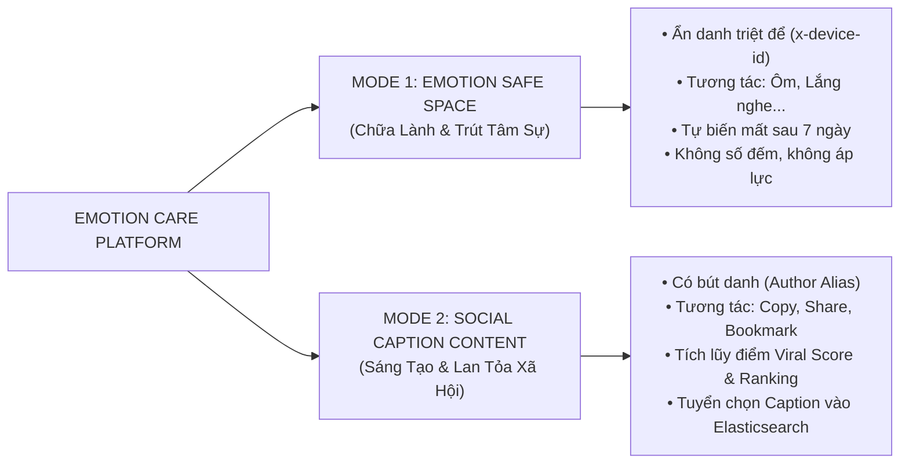
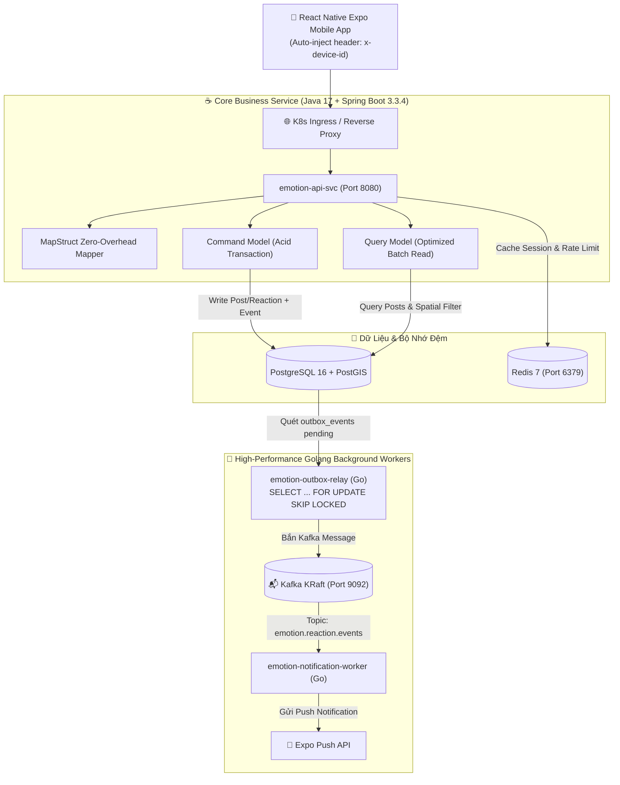
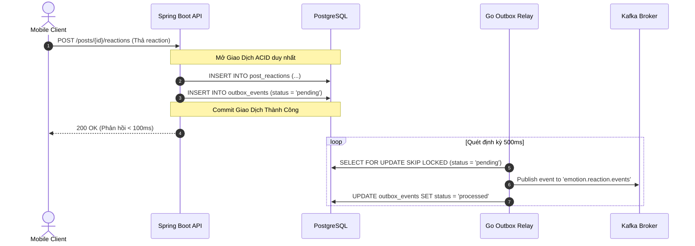

# EMOTION CARE PLATFORM
## Master System Specification & Architecture Document (Bản Hoàn Chỉnh Toàn Diện)

> **Phiên bản:** 3.0.0 (Unified Master Specification)  
> **Trạng thái:** Active / Single Source of Truth  
> **Mục tiêu:** Tài liệu hợp nhất toàn bộ tầm nhìn sản phẩm, nghiệp vụ 2 chế độ (Dual-Mode), kiến trúc phân tán Polyglot, thuật toán phân phối/xếp hạng, và đặc tả kỹ thuật database từ các tài liệu tiền nhiệm.

---

# MỤC LỤC

1. [TỔNG QUAN SẢN PHẨM & CHIẾN LƯỢC 2 CHẾ ĐỘ (DUAL-MODE)](#1-tổng-quan-sản-phẩm--chiến-lược-2-chế-độ-dual-mode)
2. [CÁC MIỀN NGHIỆP VỤ CỐT LÕI (CORE DOMAINS)](#2-các-miền-nghiệp-vụ-cốt-lõi-core-domains)
3. [BẢNG MÃ MÀU & ICON CẢM XÚC (VISUAL MOOD TAXONOMY)](#3-bảng-mã-màu--icon-cảm-xúc-visual-mood-taxonomy)
4. [KIẾN TRÚC HỆ THỐNG PHÂN TÁN (SYSTEM ARCHITECTURE)](#4-kiến-trúc-hệ-thống-phân-tán-system-architecture)
5. [MẪU THIẾT KẾ TRANSACTIONAL OUTBOX & EVENT STREAMING](#5-mẫu-thiết-kế-transactional-outbox--event-streaming)
6. [THUẬT TOÁN FEED & BẢNG XẾP HẠNG VIRAL (RANKING ENGINE)](#6-thuật-toán-feed--bảng-xếp-hạng-viral-ranking-engine)
7. [KIẾN TRÚC AI CAPTION & RAG VECTOR SEARCH](#7-kiến-trúc-ai-caption--rag-vector-search)
8. [TỪ ĐIỂN CƠ SỞ DỮ LIỆU TOÀN TẬP (DATABASE SCHEMA & DICTIONARY)](#8-từ-điển-cơ-sở-dữ-liệu-toàn-tập-database-schema--dictionary)
9. [HƯỚNG DẪN TRIỂN KHAI & VẬN HÀNH (DEVOPS & DEPLOYMENT)](#9-hướng-dẫn-triển-khai--vận-hành-devops--deployment)

---

# 1. TỔNG QUAN SẢN PHẨM & CHIẾN LƯỢC 2 CHẾ ĐỘ (DUAL-MODE)

### 1.1. Tầm Nhìn Sản Phẩm
Trong bối cảnh các mạng xã hội truyền thống (Facebook, Instagram, Threads, TikTok) ngập tràn sự phô diễn thành tích, hạnh phúc và tạo ra áp lực đồng trang lứa (Peer Pressure), **Emotion Care Platform** ra đời như một không gian nhân văn:
* Nơi cảm xúc tiêu cực (buồn bã, cô đơn, áp lực, mệt mỏi) được chấp nhận và lắng nghe an toàn.
* Nơi người dùng tìm thấy sự thấu cảm từ những người có cùng tâm trạng quanh khu vực địa lý.
* Nơi những câu từ, caption sáng tạo sâu sắc được tôn vinh và lan tỏa.

### 1.2. Chiến Lược 2 Chế Độ (Dual-Mode Architecture)

Hệ thống tích hợp 2 chế độ trải nghiệm riêng biệt nhưng bổ trợ lẫn nhau, được cấu hình trực tiếp trong phần **Cài đặt thiết bị (`Device Settings`)**:



| Tiêu chí | Mode 1: Emotion Safe Space | Mode 2: Social Caption Content |
| :--- | :--- | :--- |
| **Mục đích** | Giải tỏa áp lực tâm lý, trút bầu tâm sự. | Sáng tạo caption hay, lấy nội dung đi đăng mạng xã hội. |
| **Danh tính** | Ẩn danh 100% theo thiết bị. | Ẩn danh hoặc kèm Bút danh sáng tạo (`author_alias`). |
| **Tương tác cốt lõi**| Empathy Reactions (Ôm, Lắng nghe, Ở đây với bạn). | **Nút sao chép 1 chạm (`Copy to Clipboard`)**, Share. |
| **Vòng đời bài** | **Tự hết hạn sau 7 ngày** (`expired_at`). | **Vĩnh viễn**, tích lũy điểm thưởng và bảng xếp hạng. |
| **Xếp hạng** | Phân phối theo thời gian và bán kính địa lý. | **Leaderboard Ranking** (Top Ngày, Top Tuần, Trending). |
| **Tích hợp AI** | Nhận gợi ý an ủi nhẹ nhàng. | Caption Viral được nạp vào Elasticsearch để AI học sinh câu mới. |

---

# 2. CÁC MIỀN NGHIỆP VỤ CỐT LÕI (CORE DOMAINS)

### 2.1. Miền Thiết Bị & Quyền Riêng Tư (Device & Privacy Domain)
* **Zero Registration:** Không tài khoản, không mật khẩu. Nhận diện thiết bị qua HTTP Header `x-device-id` (UUIDv4).
* **Cài đặt cá nhân hóa (`device_settings`):**
  * `app_mode`: Lựa chọn chế độ trải nghiệm (`EMOTION_ONLY`, `SOCIAL_CAPTION`, hoặc `DUAL_MODE`).
  * `author_alias`: Bút danh hiển thị khi sáng tạo caption.
  * `approximate_location`: Làm mờ tọa độ thật khi quét bài xung quanh.
  * `low_pressure_mode`: Ẩn hoàn toàn số lượng tương tác, tắt thông báo gây xao nhãng.
  * `share_nearby` / `receive_nearby`: Quyền phát và nhận bài theo bán kính địa lý.

### 2.2. Miền Phân Loại Cảm Xúc (Emotion Taxonomy 2 Tầng)
Cảm xúc được chuẩn hóa theo mô hình phân tầng chặt chẽ:
* **Tầng 1 (Category - 6 nhóm chính):** `happy` (Vui vẻ), `sad` (Buồn), `tired` (Mệt mỏi), `stressed` (Căng thẳng), `lonely` (Cô đơn), `excited` (Phấn khích).
* **Tầng 2 (Tags - Sắc thái cảm xúc cụ thể):**
  * *Vui vẻ*: Hy vọng, Biết ơn, Bình yên.
  * *Buồn*: Chia tay, Tổn thương, Hụt hẫng.
  * *Mệt mỏi*: Mất ngủ, Cạn kiệt năng lượng.
  * *Căng thẳng*: Lo lắng, Áp lực công việc, Quá tải.
  * *Cô đơn*: Không ai hiểu mình, Cô đơn giữa đám đông.
  * *Phấn khích*: Hào hứng, Thành tựu mới.

### 2.3. Miền Tương Tác Thấu Cảm (Empathy Reaction Domain)
Thay thế nút "Like" bằng 5 phản hồi mang tính chữa lành:
1. `listen` - Lắng nghe
2. `hug` - Ôm một cái
3. `support` - Ở đây với bạn
4. `cheer` - Cố lên nhé
5. `empathy` - Tôi hiểu cảm giác này

* **Quy tắc tương tác (Toggle & Replace):** Mỗi người dùng chỉ giữ tối đa 1 reaction trên mỗi bài viết (`UNIQUE(post_id, device_id)`). Bấm vào reaction đang chọn sẽ hủy (`REMOVED`), bấm vào reaction khác sẽ đổi loại (`UPDATED`).

### 2.4. Miền An Toàn & Hỗ Trợ Khủng Hoảng (Safety & Moderation Domain)
* **Posting Rate Limit:** Giới hạn tối đa số bài đăng mỗi ngày theo thiết bị (`posting_rate_limits`) để ngăn chặn spam bot.
* **Hàng đợi kiểm duyệt nguy cơ (`moderation_queue`):** Quét từ khóa tự hại (`SELF_HARM`), tự tử (`SUICIDE`), bạo lực (`VIOLENCE`). Bài viết có điểm nguy cơ cao tự động chuyển trạng thái `Flagged (status = 2)` và hiển thị popup đường dây nóng hỗ trợ tâm lý khẩn cấp (Crisis Helpline).

---

# 3. BẢNG MÃ MÀU & ICON CẢM XÚC (VISUAL MOOD TAXONOMY)

Bảng tra cứu mã màu chữ (`color`), màu nền thẻ (`bgColor`) và bộ icon chuẩn được ánh xạ vào Mobile/Web:

| Cảm xúc | Mã Màu Chữ | Mã Màu Nền Thẻ | Danh Sách Icon Key Hỗ Trợ |
| :--- | :---: | :---: | :--- |
| **Vui vẻ (`happy`)** | `#F59E0B` | `#FEF3C7` | `sun`, `sparkles`, `rainbow`, `party-popper` |
| **Buồn (`sad`)** | `#3B82F6` | `#DBEAFE` | `cloud-rain`, `droplets`, `moon`, `umbrella` |
| **Mệt mỏi (`tired`)** | `#8B5CF6` | `#EDE9FE` | `bed`, `moon-star`, `battery-low`, `coffee` |
| **Căng thẳng (`stressed`)** | `#EF4444` | `#FEE2E2` | `zap`, `flame`, `alarm`, `cloud-lightning` |
| **Cô đơn (`lonely`)** | `#6366F1` | `#E0E7FF` | `moon`, `heart-crack`, `cloud`, `person` |
| **Phấn khích (`excited`)** | `#F97316` | `#FFEDD5` | `rocket`, `trophy`, `sparkles`, `party-popper` |

---

# 4. KIẾN TRÚC HỆ THỐNG PHÂN TÁN (SYSTEM ARCHITECTURE)

Hệ thống được thiết kế theo mô hình **Polyglot Event-Driven Microservices + CQRS Lite**:



### Điểm Mạnh Công Nghệ:
1. **Spring Boot 3 (Core Service):** Quản lý toàn vẹn giao dịch DB phức tạp, Liquibase schema migration, MapStruct tối ưu bộ nhớ thay thế Reflection.
2. **Golang (Workers):** Tiêu thụ siêu ít RAM (~15MB/worker), sử dụng Goroutines non-blocking để xử lý hàng chục ngàn sự kiện Kafka mỗi giây.
3. **PostGIS (Spatial Engine):** Tính toán khoảng cách địa lý theo tọa độ thực mà không cần xử lý thuật toán phức tạp trên code ứng dụng.

---

# 5. MẪU THIẾT KẾ TRANSACTIONAL OUTBOX & EVENT STREAMING

Để loại bỏ hoàn toàn lỗi không đồng bộ giữa Database và Message Broker (Dual-Write Failure):



### Đặc Tả Cấu Trúc Outbox Event Envelope
```json
{
  "id": "c1f7a240-67c2-494b-9e4a-4e2b023e1f01",
  "aggregateType": "POST_REACTION",
  "aggregateId": "550e8400-e29b-41d4-a716-446655440000",
  "eventType": "REACTION_ADDED",
  "idempotencyKey": "REACTION:550e8400:device-01:ADDED:1732262400000",
  "status": "pending",
  "payload": {
    "postId": "550e8400-e29b-41d4-a716-446655440000",
    "postAuthorDeviceId": "8b846e4b-7221-4389-9a22-38e92ec4917a",
    "actorDeviceId": "9c123456-7890-4321-b123-abcdef123456",
    "reactionTypeId": 2,
    "reactionTypeName": "Ôm một cái",
    "action": "ADDED",
    "timestamp": "2026-11-22T15:45:00Z"
  }
}
```

---

# 6. THUẬT TOÁN FEED & BẢNG XẾP HẠNG VIRAL (RANKING ENGINE)

### 6.1. Thuật Toán Truy Vấn Feed Cảm Xúc Lân Cận (Mode 1)
Sử dụng hàm PostGIS `ST_DWithin` trên hệ tọa độ không gian `WGS 84` (`SRID 4326`):

```sql
SELECT p.*, 
       ST_Distance(p.location, ST_SetSRID(ST_MakePoint(:userLng, :userLat), 4326)::geography) AS distance_meters
FROM emotion_posts p
WHERE p.status = 1 
  AND p.post_mode = 'EMOTION'
  AND p.expired_at > CURRENT_TIMESTAMP
  AND ST_DWithin(
        p.location, 
        ST_SetSRID(ST_MakePoint(:userLng, :userLat), 4326)::geography, 
        p.visibility_radius_m
      )
ORDER BY p.created_at DESC
LIMIT :limit;
```

### 6.2. Thuật Toán Tính Điểm Lan Tỏa & Xếp Hạng Caption Viral (Mode 2)
Điểm số Viral được tính tự động dựa trên mức độ tương tác thực tế và độ trễ thời gian (Gravity Decay):

$$\text{Viral Score} = \frac{5.0 \cdot \text{Copy} + 3.0 \cdot \text{Share} + 1.5 \cdot \text{Reaction} + 0.5 \cdot \log_{10}(\text{View} + 1)}{(T + 2)^{1.8}}$$

* **Hành vi Copy (`W_copy = 5.0`):** Được gán trọng số cao nhất vì hành vi sao chép caption thể hiện giá trị cao nhất của nội dung.
* **Thời gian suy giảm ($T$ - số giờ trôi qua):** Mẫu số $(T + 2)^{1.8}$ đảm bảo các caption xuất sắc mới đăng luôn có cơ hội vươn lên Top Trending thay vì bị các bài cũ chiếm sóng mãi mãi.

---

# 7. KIẾN TRÚC AI CAPTION & RAG VECTOR SEARCH

### 7.1. Bánh Đà Dữ Liệu Tuyển Chọn Caption (Curating Pipeline)
Khi một bài viết ở Mode 2 đạt điều kiện viral (`viral_score >= 100` hoặc `copy_count >= 50`), hệ thống kích hoạt quy trình tuyển chọn:
1. Sinh event `CAPTION_CURATED_FOR_ES`.
2. Worker trích xuất Dense Vector Embedding (768 chiều).
3. Index vào Elasticsearch index `viral_captions`.
4. Đánh dấu `is_curated_to_es = true`.

### 7.2. Luồng Sinh Caption AI Bằng Kỹ Thuật RAG
Khi người dùng cần gợi ý câu từ, hệ thống không gọi LLM đơn thuần mà thực hiện theo quy trình RAG:
1. **Semantic Vector Search:** Dựa vào cảm xúc đã chọn, Elasticsearch thực hiện tìm kiếm k-NN lấy ra Top-5 caption viral hay nhất đã có trong cơ sở tri thức.
2. **Context Injection:** Đưa 5 caption mẫu này vào Prompt của LLM (chạy qua **Ollama** hoặc **Gemini API**).
3. **Multimodal Generation:** LLM sinh ra đúng 3 câu mới theo 3 phong cách:
   * **[GENTLE]**: Nhẹ nhàng, chấp nhận và vỗ về cảm xúc.
   * **[DIRECT]**: Bộc trực, chân thật về điều đè nặng trong lòng.
   * **[EXPRESSIVE]**: Giàu hình ảnh nghệ thuật và ẩn dụ.

---

# 8. TỪ ĐIỂN CƠ SỞ DỮ LIỆU TOÀN TẬP (DATABASE SCHEMA & DICTIONARY)

### Danh Sách 18 Bảng Chuẩn

| STT | Tên Bảng | Ý nghĩa nghiệp vụ | Khóa chính | Khóa ngoại |
| :---: | :--- | :--- | :---: | :--- |
| **1** | `devices` | Danh sách thiết bị ẩn danh | `id` (UUID) | Không |
| **2** | `device_settings` | Cấu hình riêng tư & Chế độ app | `device_id` (UUID) | $\rightarrow$ `devices(id)` |
| **3** | `device_locations` | Lịch sử tọa độ check-in | `id` (BIGSERIAL) | $\rightarrow$ `devices(id)` |
| **4** | `device_push_tokens` | Token gửi thông báo Expo | `id` (UUID) | $\rightarrow$ `devices(id)` |
| **5** | `emotion_categories` | 6 danh mục cảm xúc chính | `id` (SMALLINT) | Không |
| **6** | `emotion_tags` | Các sắc thái cảm xúc con kèm màu/icon | `id` (INT) | $\rightarrow$ `emotion_categories(id)` |
| **7** | `emotion_posts` | Bài đăng cảm xúc / Caption content | `id` (UUID) | $\rightarrow$ `devices`, `categories` |
| **8** | `emotion_post_tags` | Bảng liên kết N-N Post - Tag | `(post_id, tag_id)`| $\rightarrow$ `posts`, `tags` |
| **9** | `reaction_types` | 5 loại biểu cảm thấu cảm | `id` (SMALLINT) | Không |
| **10**| `post_reactions` | Ghi nhận tương tác thả biểu cảm | `id` (BIGSERIAL) | $\rightarrow$ `posts`, `devices`, `reaction_types` |
| **11**| `ai_suggestions` | Lịch sử các câu AI gợi ý | `id` (UUID) | $\rightarrow$ `emotion_posts(id)` |
| **12**| `posting_rate_limits`| Chống spam đăng bài theo ngày | `(device_id, post_date)`| $\rightarrow$ `devices(id)` |
| **13**| `moderation_queue` | Hàng đợi kiểm duyệt khủng hoảng/tự hại | `id` (BIGSERIAL) | $\rightarrow$ `emotion_posts(id)` |
| **14**| `notification_templates`| Mẫu tiêu đề và nội dung thông báo | `id` (INT) | Không |
| **15**| `notification_settings` | Cài đặt nhận thông báo của thiết bị | `device_id` (UUID) | $\rightarrow$ `devices(id)` |
| **16**| `notifications` | Bản ghi thông báo gửi đến người dùng | `id` (UUID) | $\rightarrow$ `devices(id)` |
| **17**| `notification_queue` | Hàng đợi retry thông báo lỗi | `id` (BIGSERIAL) | $\rightarrow$ `notifications(id)` |
| **18**| `outbox_events` | Bảng Transactional Outbox phân tán | `id` (UUID) | Khóa Idempotency duy nhất |

---

# 9. HƯỚNG DẪN TRIỂN KHAI & VẬN HÀNH (DEVOPS & DEPLOYMENT)

### 9.1. Khởi Động Nhanh Trên Môi Trường Local (One-Command Dev)
* **Hạ tầng chính (PostgreSQL, Redis, Kafka)**:
  ```powershell
  .\start-services.ps1
  ```
* **Hạ tầng AI RAG Stack (Ollama, OpenWebUI, Elasticsearch, Kibana)**:
  ```powershell
  docker compose -f docker-compose.ai.yml up -d
  ```
* **Dừng an toàn toàn bộ**:
  ```powershell
  .\stop-services.ps1
  ```

### 9.2. Cấu Hình Cổng Dịch Vụ Mặc Định

| Dịch vụ | Địa chỉ kết nối | Thông tin đăng nhập |
| :--- | :--- | :--- |
| **Backend API** | `http://localhost:8080` | Swagger UI: `/swagger-ui.html` |
| **PostgreSQL 16** | `localhost:5432` | DB: `emotion_care` \| User/Pass: `postgres`/`postgrespassword` |
| **Redis 7** | `localhost:6379` | Pass: `redispassword` |
| **Kafka KRaft** | `localhost:9092` | Listener: PLAINTEXT |
| **Ollama Local LLM** | `http://localhost:11434`| API REST |
| **Open WebUI** | `http://localhost:5000` | Chat testing UI |
| **Elasticsearch** | `http://localhost:9200` | Vector Database (xpack disabled) |
| **Kibana** | `http://localhost:5601` | Quản trị Index ES |

---

> [!NOTE]
> Mọi thay đổi trong tương lai về kiến trúc, database schema hoặc quy tắc nghiệp vụ đều phải được cập nhật đồng bộ vào tài liệu [docs/MASTER-SPECIFICATION.md](file:///c:/source/emotion-care/docs/MASTER-SPECIFICATION.md) này để đảm bảo tính nhất quán của toàn dự án.
