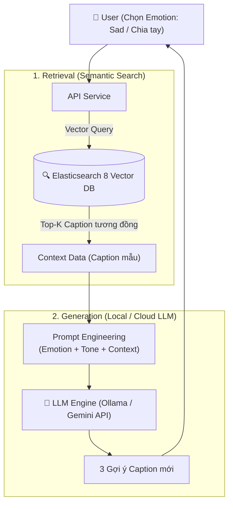

# AI Caption Generator & RAG Architecture Specification

Tài liệu này đặc tả kiến trúc, luồng hoạt động và hạ tầng triển khai mô hình **RAG (Retrieval-Augmented Generation)** để tự động sinh Caption cảm xúc cho Emotion Care Platform (chuyển giao và chuẩn hóa từ `personal-status-be`).

---

## 1. Bài Toán & Mục Tiêu Nghiệp Vụ

Trong ứng dụng Emotion Care, người dùng thường gặp khó khăn khi diễn đạt nội tâm:
* Khi cảm thấy buồn, cô đơn, áp lực, người dùng muốn chia sẻ nhưng **không biết viết gì**.
* Sợ viết quá dài dòng hoặc không tìm được câu chữ đồng điệu.

### Mục tiêu của AI Caption Engine:
1. **Gợi ý tức thì (Zero-Click Expression):** Dựa vào cảm xúc người dùng chọn (`emotion`, `tag`), AI đưa ra 3 - 5 gợi ý câu diễn đạt ngắn gọn, sâu sắc.
2. **Tránh trùng lặp (Diversity):** Sử dụng Vector Semantic Search để không gợi ý những câu đã xuất hiện quá nhiều lần.
3. **Đa phong cách (Multimodal Tones):**
   * *Gentle*: Nhẹ nhàng, tự an ủi bản thân.
   * *Direct*: Chân thật, bộc trực về cảm xúc hiện tại.
   * *Expressive*: Mang tính thơ, triết lý hoặc hình ảnh ẩn dụ.

---

## 2. Kiến Trúc RAG (Retrieval-Augmented Generation)



---

## 3. Hạ Tầng Triển Khai AI Local (Docker Compose)

Hệ thống hỗ trợ chạy local thông qua Docker compose độc lập [docker-compose.ai.yml](file:///c:/source/emotion-care/docker-compose.ai.yml):

| Service | Image | Cổng Port | Mục đích |
| :--- | :--- | :--- | :--- |
| **`ollama`** | `ollama/ollama` | `11434` | Chạy các mô hình ngôn ngữ mã nguồn mở (như `llama3`, `mistral`, `phind`) không tốn chi phí API token. |
| **`open-webui`** | `ghcr.io/open-webui/open-webui:main` | `5000` | Giao diện Web trực quan để kiểm thử prompt và tương tác trực tiếp với Ollama. |
| **`elasticsearch`** | `docker.elastic.co/elasticsearch/elasticsearch:8.14.3` | `9200` | Vector Database lưu trữ dense vector embedding của hàng ngàn câu caption mẫu. |
| **`kibana`** | `docker.elastic.co/kibana/kibana:8.14.3` | `5601` | Dashboard quản trị dữ liệu vector và index mapping của Elasticsearch. |

---

## 4. Đặc Tả Prompt Engineering Cho AI Caption

```text
SYSTEM PROMPT:
Bạn là trợ lý tâm lý thấu cảm của Emotion Care Platform. 
Nhiệm vụ của bạn là giúp người dùng diễn đạt cảm xúc chân thật, nhẹ nhàng và an ủi.

INPUT:
- Nhóm cảm xúc chính: {category} (ví dụ: Buồn, Căng thẳng, Cô đơn)
- Sắc thái cụ thể: {tag} (ví dụ: Chia tay, Mất ngủ, Áp lực công việc)
- Ngôn ngữ: {language} (vi, en, ko, ja)

YÊU CẦU ĐẦU RA:
Sinh đúng 3 câu ngắn gọn (dưới 30 từ mỗi câu) tương ứng 3 phong cách:
1. [GENTLE] - Một câu vỗ về, chấp nhận cảm xúc hiện tại.
2. [DIRECT] - Một câu bộc bạch trực tiếp điều đang đè nặng trong lòng.
3. [EXPRESSIVE] - Một câu có hình ảnh ẩn dụ (mây mưa, đêm dài, bước chân...).
Không dùng các từ ngữ sáo rỗng hoặc khuyên bảo giáo điều.
```
