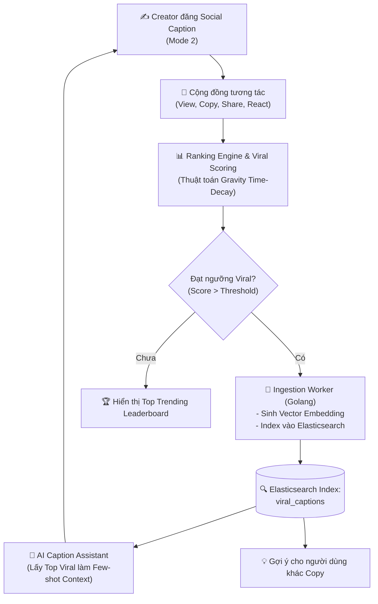

# Dual-Mode Platform Architecture: Emotion Safe Space & Viral Caption Social

> **Định hướng cốt lõi:** Nền tảng kết hợp 2 chế độ (Dual Mode):
> 1. **Mode 1 - Emotion Safe Space:** Nơi trút bầu tâm sự ẩn danh, nhẹ nhàng, không câu like, không phán xét, tự chữa lành.
> 2. **Mode 2 - Social Caption Content:** Nơi sáng tạo, xếp hạng và lan tỏa các Caption Viral. Các caption thịnh hành sẽ được tuyển chọn tự động/bán tự động đưa vào Elasticsearch Vector Database để phục vụ RAG và tái tạo lan tỏa (Growth Loop).

---

## 1. So Sánh Hai Chế Độ (Dual-Mode Comparison)

| Đặc tính | Mode 1: Emotion Safe Space | Mode 2: Social Caption Content |
| :--- | :--- | :--- |
| **Mục đích chính** | Trút bỏ áp lực, tìm kiếm sự lắng nghe, đồng cảm. | Sáng tạo câu từ, lấy caption đăng Facebook / Threads / TikTok / Instagram. |
| **Tính chất danh tính** | Ẩn danh triệt để (`x-device-id`), không tên tuổi. | Có thể kèm Nickname / Bút danh của tác giả sáng tạo. |
| **Tương tác cốt lõi** | Empathy Reactions (Ôm, Lắng nghe, Ở đây với bạn). | Copy to Clipboard, Share, Thả tim, Bookmark/Lưu trữ. |
| **Vòng đời bài viết** | **7 ngày tự biến mất** (Cảm xúc nhất thời). | **Vĩnh viễn**, tích lũy điểm Viral Score & Ranking. |
| **Cơ chế xếp hạng** | Không xếp hạng, phân phối theo thời gian và bán kính địa lý. | **Leaderboard & Ranking** (Top Ngày, Top Tuần, Trending theo Cảm xúc). |
| **Tích hợp AI/ES** | Nhận an ủi nhẹ nhàng từ AI. | Tuyển chọn Caption hay $\rightarrow$ Index vào Elasticsearch Vector DB. |

---

## 2. Vòng Lặp Lan Tỏa (Viral Growth Loop & Data Flywheel)



---

## 3. Thuật Toán Xếp Hạng & Điểm Lan Tỏa (Viral Score Algorithm)

Để đánh giá một caption có thực sự "Viral" hay không, hệ thống sử dụng công thức tính điểm kết hợp hành vi và độ suy giảm thời gian (tương tự Hacker News / Reddit Gravity):

$$\text{Viral Score} = \frac{W_{\text{copy}} \cdot C + W_{\text{share}} \cdot S + W_{\text{react}} \cdot R + W_{\text{view}} \cdot \log_{10}(V)}{(T + 2)^G}$$

Trong đó:
* $C$: Số lượt sao chép vào bộ nhớ tạm (**Copy count** - hành vi quan trọng nhất của caption). Trọng số $W_{\text{copy}} = 5.0$.
* $S$: Số lượt chia sẻ ra ngoài (**Share count**). Trọng số $W_{\text{share}} = 3.0$.
* $R$: Số lượng phản hồi đồng cảm (**Reactions**). Trọng số $W_{\text{react}} = 1.5$.
* $V$: Số lượt xem (**Impression/View count**). Trọng số $W_{\text{view}} = 0.5$.
* $T$: Số giờ trôi qua kể từ khi đăng bài.
* $G$: Hệ số suy giảm trọng lực (Gravity, mặc định $G = 1.8$ để caption mới có cơ hội lên Top).

---

## 4. Thiết Kế Mở Rộng Cơ Sở Dữ Liệu (Schema Enhancement)

### 4.1. Bổ sung trường cho bảng `emotion_posts`
```sql
ALTER TABLE emotion_posts 
ADD COLUMN IF NOT EXISTS post_mode VARCHAR(20) NOT NULL DEFAULT 'EMOTION', -- 'EMOTION' hoặc 'SOCIAL_CAPTION'
ADD COLUMN IF NOT EXISTS author_alias VARCHAR(100),                         -- Bút danh tùy chọn ở Mode 2
ADD COLUMN IF NOT EXISTS copy_count INT NOT NULL DEFAULT 0,
ADD COLUMN IF NOT EXISTS share_count INT NOT NULL DEFAULT 0,
ADD COLUMN IF NOT EXISTS view_count INT NOT NULL DEFAULT 0,
ADD COLUMN IF NOT EXISTS viral_score NUMERIC(10, 4) NOT NULL DEFAULT 0.0,
ADD COLUMN IF NOT EXISTS is_curated_to_es BOOLEAN NOT NULL DEFAULT FALSE,
ADD COLUMN IF NOT EXISTS curated_at TIMESTAMPTZ;

CREATE INDEX IF NOT EXISTS idx_posts_mode ON emotion_posts(post_mode);
CREATE INDEX IF NOT EXISTS idx_posts_viral_score ON emotion_posts(viral_score DESC) WHERE post_mode = 'SOCIAL_CAPTION';
```

### 4.2. Elasticsearch Vector Index Mapping (`viral_captions`)
```json
{
  "mappings": {
    "properties": {
      "post_id": { "type": "keyword" },
      "caption_text": { "type": "text", "analyzer": "standard" },
      "category_code": { "type": "keyword" },
      "tag_names": { "type": "keyword" },
      "author_alias": { "type": "keyword" },
      "copy_count": { "type": "integer" },
      "viral_score": { "type": "float" },
      "embedding_vector": {
        "type": "dense_vector",
        "dims": 768,
        "index": true,
        "similarity": "cosine"
      },
      "created_at": { "type": "date" }
    }
  }
}
```

---

## 5. Quy Trình Tuyển Chọn Tự Động Sang Elasticsearch (Curating Pipeline)

1. **Trigger:**
   * Khi một caption đạt điều kiện: `copy_count >= 50` hoặc `viral_score >= 100.0`.
   * Hoặc Admin bấm duyệt thủ công ("Curate this caption") trên Admin Panel.
2. **Transactional Outbox Event:**
   * Hệ thống ghi event `CAPTION_CURATED_FOR_ES` vào `outbox_events`.
3. **Worker Processing:**
   * Go Outbox Relay bắn event sang Kafka topic `caption.curated.events`.
   * Một Embedding Worker tiêu thụ topic này, gọi mô hình Embedding (Ollama `nomic-embed-text` hoặc Gemini Embeddings API) để trích xuất vector 768 chiều.
   * Đẩy document hoàn chỉnh vào Elasticsearch index `viral_captions`.
   * Đánh dấu `is_curated_to_es = true` trong database.

---

## 6. Trải Nghiệm Người Dùng Trên Mobile (UI/UX Dual-Mode)

* **Thanh chuyển đổi chế độ (Mode Switcher) ở đầu màn hình:**
  * Tab 1: **"Chữa Lành" (Safe Space)**: Giao diện nền tối nhẹ, hiển thị bài tâm sự, khoảng cách km, reaction thấu cảm.
  * Tab 2: **"Kho Caption Viral" (Social Studio)**: Giao diện sáng, typography nổi bật, có nút **[Copy]** nhanh 1 chạm, huy hiệu **Top 1 Trending**, bộ lọc cảm xúc (Thả thính, Suy sụp, Triết lý, Trưởng thành...).
